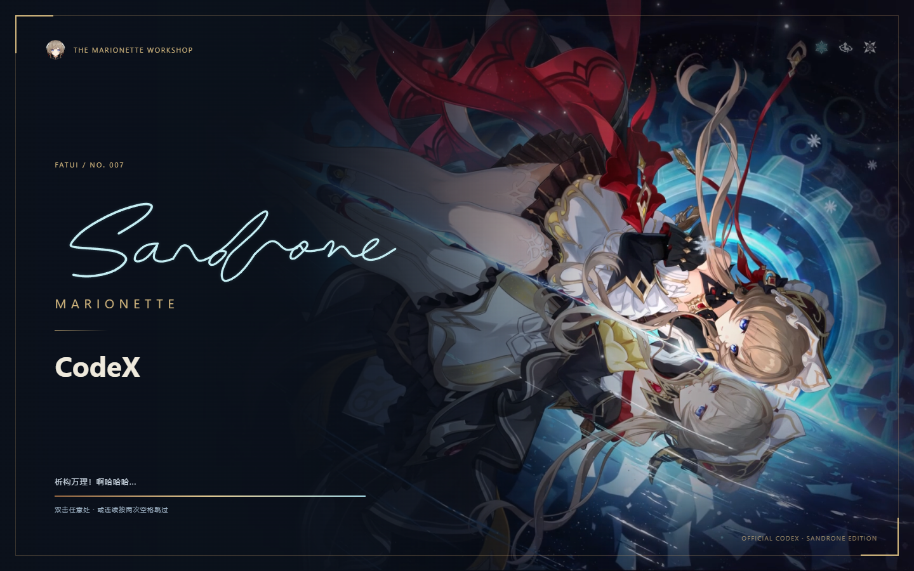

# Sandrone Codex · 桑多涅人偶工坊

为 **Windows 11 x64 上的官方 Codex 桌面客户端**制作的非官方桑多涅主题与启动器。

保留官方 AI、模型、MCP 与审批，增加角色背景、黑金配色、同窗开屏、手写签名和重播入口。



## 下载并直接使用

**[下载完整启动器 v0.6.1](https://github.com/fengye337/sandrone-codex/releases/download/v0.6.1/SandroneCodex-0.6.1-Windows-x64.zip)** · [全部发布文件](https://github.com/fengye337/sandrone-codex/releases)

完整版带桑多涅立绘、视频、轮廓、签名和 Node 运行时，普通使用者不需要 Git、Python、npm 或自行编译。

1. 自行安装官方 Windows Codex，正常打开并登录一次。
2. 完整解压启动器 ZIP 到本机可写目录，不要在压缩包内直接运行。
3. 双击 `检查安装.cmd`，再双击 `安装快捷方式.cmd`。
4. 保存工作，从托盘手动完全退出已有 Codex，打开桌面「桑多涅 Codex（分享版）」。
5. 独立 profile 首次可能需要手动登录自己的账号；不会复制原账号凭据。

无需固定盘符；移动目录后重新安装快捷方式。此包不包含官方 Codex 程序、账号或模型额度。

## 主题细节

- 同窗开屏：橙色人物矢量描边，蓝色齿轮和水纹，逐笔 Sandrone 手签，显色后淡入工作界面。
- 连续运动：原片环境描边预渲染，与彩色视频同步；显色不重新从头播放视频。
- 双击、连续两次空格/Enter 或 Esc 跳过；顶栏「重播开屏」只重播动画，不重启或重跑任务。
- 加粗 CodeX；解算开始。→ 填入变量。→ 进程良好。→ 析构万理！啊哈哈哈...（文字）。
- 右侧立绘、透明工具栏、黑金侧栏、象牙白文字与深蓝输入框；首页「机巧镀形，万理澄清」。
- 修复 ChatGPT 正文、项目表单、菜单、设置、代码和活动标题的可读性；图片查看器/弹窗打开时重播按钮让位。
- 开屏结束暂停媒体并保留当前窗口缓存，禁用主题时完全释放；日常背景保持静态，支持减少动态效果偏好。见 [开屏预加载与缓存](docs/OPENING-PERFORMANCE.zh-CN.md)。

更多内容见 [功能清单](docs/FEATURES.zh-CN.md)。

## 恢复官方界面

保存工作后运行 `一键恢复官方原版.cmd`；它只处理身份匹配的主题会话，移除主题、正常退出，再打开官方入口。

也可以手动从托盘退出主题版，再打开原来的官方快捷方式。官方 WindowsApps 文件从未被修改。`移除快捷方式.cmd` 只移除指向当前目录的分享版入口。

## 可选：在普通 Codex 中加载和管理主题

新增的 Windows 原生附加包可从普通 Codex 入口加载主题，沿用原有配置，不需要专用启动器或远程调试端口。界面中的「主题」菜单提供启用、回到原生界面、重播、启动播放开关，就绪后自动进入开关，以及退出后卸载和取消卸载。

这是可卸载的 MSIX modification package，不是官方插件目录中的插件。当前适配 `26.1021.3705.0`，本地构建使用该版本官方签名 MSIX；不修改官方安装文件，也不强制退出当前聊天。卸载确认后先禁用主题，等待用户退出 Codex 再移除附加包。

0.3.1.0 提前显示开屏，以预渲染视频配合真实阶段进度，并修复启动握手导致开屏与重播失效的问题。自动模式等待工作区就绪及片头播完，手动模式就绪后双击进入。修复版已安装，普通启动与重播的原生日志均确认播放并进入工作区；首次绘制与性能对比的验证范围见 [启动进度说明](docs/STARTUP-READINESS.zh-CN.md)。

0.3.5.0 将原生开屏升级为 1080p／60 fps，保持 5.2 秒片头与 9 秒循环；源人物视频仍是 30 fps，具体测试结果和限制见 [启动进度说明](docs/STARTUP-READINESS.zh-CN.md#60-fps-版本与验收)。

0.3.2.0 增加可复跑的动画制作脚本与构建校验：工程或素材变化、视频缺失或损坏时，构建会重新生成并核对来源版本，失败则停止打包。视频继续随包提供，用户安装和日常启动都不需要渲染工具。制作入口与依赖见 [构建时生成开屏](docs/STARTUP-READINESS.zh-CN.md#构建时生成开屏)。

构建、兼容范围和实际验证状态见 [原生集成说明](docs/NATIVE-INTEGRATION.zh-CN.md)。原启动器继续可用，两种加载方式分别选择。

## 从源码构建完整桑多涅版本

**本仓库已包含桑多涅主题素材。** 源码不携带预编译 EXE/DLL 或 Node 二进制。

准备官方 Node.js 24 LTS Windows x64 和配套 LICENSE。可以正常安装 Node，或把官方 ZIP 中的 `node.exe` 和 `LICENSE` 放入 `runtime/`，然后执行：

```powershell
.\Build-From-Source.ps1
.\Setup.ps1
```

也可双击 `从源码构建.cmd`。使用 Windows 自带 .NET Framework 编译器，生成启动器、窗口组件、离线预览、标准主题包和完整性清单；不需要 npm 或 Python。修改代码或素材后重新构建，不要绕过摘要检查。

## 兼容与安全边界

- 本机验证：Windows 11 x64、官方 Codex 26.1016.8622.0；发行版 0.6.1，主题扩展 0.5.3。
- 依赖官方 UI 结构；其他版本、首次冷启动、真实聊天/模型/MCP/审批仍需使用者验证。
- 官方与主题入口需要手动退出切换，不保证同时运行。
- 固定调试端口 19337 只允许回环，并核验进程与 browser ID；本机其他进程仍可能访问它。
- 不修改官方安装或系统防护，不自动登录、不上传凭据、不迁移聊天或 MCP 配置。
- 本地编译启动器未做商业签名；核对发布文件 SHA256，不要关闭系统防护。
- 使用后的 profile/、state/、machine.json 不应重新打包或提交。

## 许可与鸣谢

**项目代码：MIT。** 上游 [Codex Dream Skin](https://github.com/Fei-Away/Codex-Dream-Skin) 使用 MIT，保留其许可证与来源记录。

**桑多涅名称、角色图片、视频、签名参考及衍生素材保留原权利人的权利，不适用代码的 MIT 许可。** 本项目不声称拥有这些素材，也不提供额外的素材再授权。见 [素材权利说明](ASSET-LICENSE.md) 和 assets/PROVENANCE.json。

这是非官方同人主题，与 OpenAI、HoYoverse/COGNOSPHERE 无官方隶属或背书关系。
